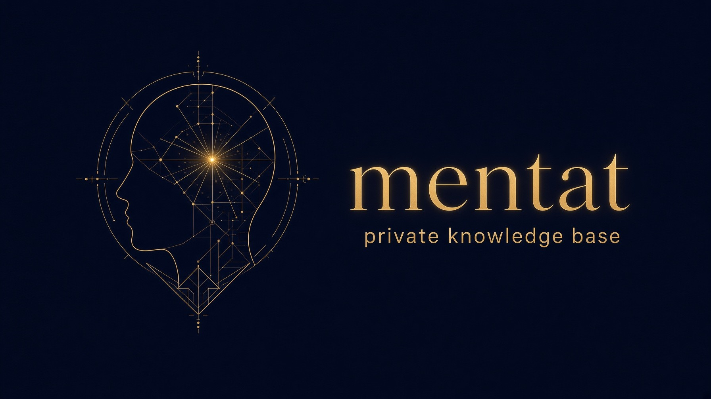

# mentat-template

A private knowledge base that your AI tools share. Short markdown notes about your work and life admin, linked with `[[wiki links]]`, served to Claude, OpenCode and other MCP clients from a small Cloudflare Worker. Stop explaining your context again in every chat.

This repo is a template, filled with demo notes about a made-up person. Click **Use this template**, make the new repo **private**, and replace the notes with your own.

## Try the demo

- **Map:** https://mentat-demo.idk.ie/graph
- **Connector:** add `https://mentat-demo.idk.ie/mcp` to Claude or OpenCode as a custom connector, with no sign-in. Then ask *"What is Robin working on?"*

The demo is read-only and holds only the made-up notes in this repo. Your own copy has GitHub sign-in and is private.

## What you get

- **Notes as files.** `me.md`, then `areas/`, `projects/`, `people/` and monthly `logs/`. Open the folder in Obsidian, or edit it anywhere.
- **An MCP server** (`mcp/`) on Cloudflare Workers. Tools to read, search, list, follow links and read the latest log.
- **Sign-in with GitHub, for one account only.** Matched by numeric user ID, not login, so a renamed or reclaimed login can't get in.
- **Writes only as pull requests** (optional). Chats can propose a log line or a note change. Nothing changes until you merge. Paths, sizes and secret-looking text are checked first.
- **Log PRs merge on their own** after 72 hours. New and changed notes always wait for you.
- **A map in your browser** at `/graph`, behind the same sign-in.
- **CI** that builds an index and link graph, checks for secrets and private data, runs the tests and deploys the Worker.

## Get started

1. **Use this template** and make the new repo private.
2. Replace `me.md` and the demo notes with your own. See [AGENTS.md](AGENTS.md) for the note format.
3. Follow [docs/mcp.md](docs/mcp.md) to deploy the server and connect Claude or OpenCode.
4. Optional: [docs/setup.md](docs/setup.md) for Obsidian and importing old chats.

## Keep it private

Your notes repo should be private. Never commit raw chat exports, bank details, ID numbers or passwords. CI runs gitleaks and a private-data check on every push, but they are a safety net, not a guarantee.

## Licence

MIT. See [LICENSE](LICENSE).
